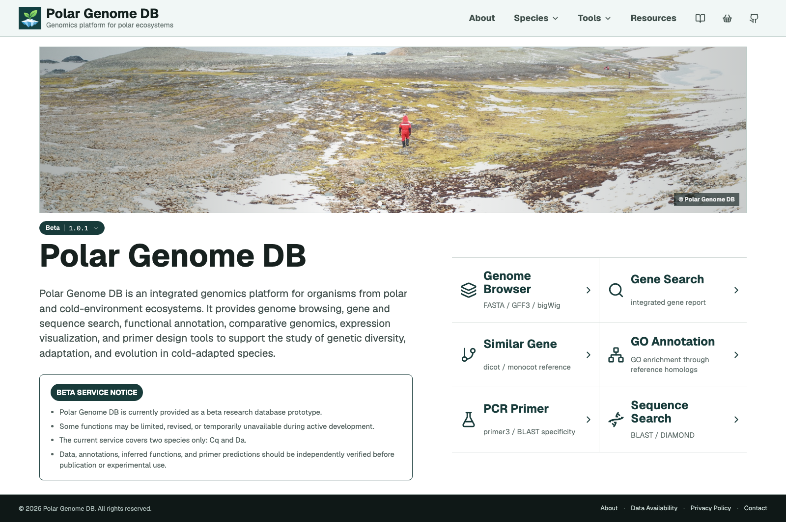
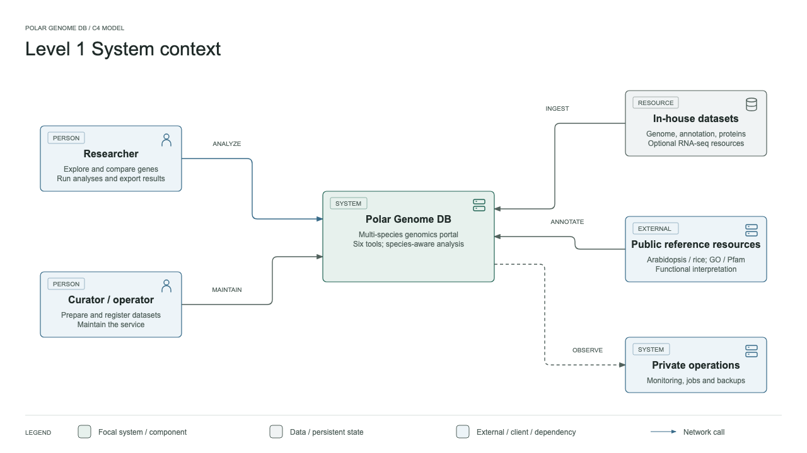

# Polar Genome DB

Polar Genome DB is a public beta genomics platform for gene-centered exploration and analysis of organisms from polar and cold-environment ecosystems.


```text
https://polargdb.org
```



## Overview

Polar Genome DB brings genome browsing, gene and sequence search, reference-based functional interpretation, expression visualization and PCR primer design into one multi-species workspace.

The current beta covers *Colobanthus quitensis* (Cq) and *Deschampsia antarctica* (Da). Reference-based analyses use Arabidopsis for dicots and rice for monocots to support functional interpretation across species.

Version `v1.0.1-beta` updates the privacy policy and Home release notes, prepares source code for public release, and adds architecture documentation. The screenshot shows the local frontend; the hosted service may be updated separately.

## Tools

- Genome Browser
- Gene Search
- Similar Gene
- GO Annotation: standard enrichment and semantic GO
- PCR Primer Design
- Sequence Search: BLASTn, BLASTp and DIAMOND
- Gene Basket for collecting genes across results

## Architecture

The system context below shows how researchers, dataset curators and reference resources relate to the platform.



## Repository Scope

This repository contains selected scientific backend code, API routes, a React frontend, manifest-driven dataset builders and synthetic unit tests. The analysis implementations are included; running them requires independently supplied datasets and scientific dependencies.

Genome assemblies, annotations, RNA-seq files, databases and runtime indexes are not distributed here. Private documents and production operations are also excluded. The pilot in-house datasets are not available for download in this release.

Runtime photographs and branding assets are replaced by placeholders in the source snapshot. The Home screenshot above is included for interface documentation, not as a standalone image collection.

See [Getting Started](GETTING_STARTED.md) for installation and dataset preparation, and [Source Changes](SOURCE_CHANGES.md) for the source-export boundary.

## License

Original source code and technical documentation are available under the [MIT License](LICENSE). Photographs and branding visible in the screenshot are excluded; third-party materials retain their own licenses. See [NOTICE.md](NOTICE.md) for scope and exceptions.

## Changelog

Release notes are tracked in [CHANGELOG.md](CHANGELOG.md).

## Disclaimer

Polar Genome DB is a beta-stage research resource. Reference-inferred annotations, expression patterns, phylogenetic comparisons and primer predictions are supporting evidence and require independent biological and experimental validation.

## Contact

Platform and analysis pipeline developed by Janghyun Choi, Ph.D., Inha University.

```text
jchoi@inha.ac.kr
```
